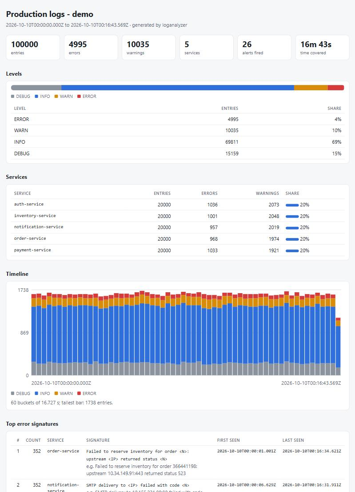

# log-analyzer

A real-time log analytics and alerting engine in modern C++17 — a tiny Datadog/Splunk.
Every data structure and algorithm is implemented from scratch (no `std::priority_queue`,
no `std::regex`, no search libraries) because the point of this project is DSA practice
on a problem every backend team actually has.

## What it does (roadmap)

| Week | Milestone | DSA |
|------|-----------|-----|
| 1 ✅ | Log generator + parser, k-way merge of per-service logs by timestamp, Top-K error signatures | min-heap, hash map, k-way merge |
| 2 ✅ | Real-time alert rules ("more than N errors in W seconds"), cooldowns | sliding window (ring buffer), per-rule hash map |
| 3 ✅ | Search: prefix autocomplete, keyword search, multi-keyword queries | trie, KMP, inverted index |
| 4 | CLI polish, dashboard / HTTP API | — |
| 5 | Probabilistic structures + benchmarks on 1M logs | Count-Min Sketch, HyperLogLog |

## Log format

```
{ISO-8601 UTC instant} {LEVEL} {service} {message...}
2026-10-10T12:00:00.123Z ERROR payment-service Timeout calling bank gateway after 3000ms
```

## Build & test

Requires CMake >= 3.16 and a C++17 compiler (developed with MSVC 2019 Build Tools).

```powershell
./build.ps1                  # Release build + run all tests (Windows)
./build.ps1 -Filter MinHeap  # only tests whose name contains "MinHeap"
```

Anywhere else:

```sh
cmake -S . -B build -DCMAKE_BUILD_TYPE=Release
cmake --build build
./build/loganalyzer_tests
```

Wall-clock performance assertions are opt-in because timing ratios are flaky on a busy
machine: set `LOGANALYZER_PERF_TESTS=1` to include them. `tools/quick.ps1 ... -Asan` runs a
subset under AddressSanitizer.

## Usage

```
loganalyzer generate --out-dir DIR [--count N] [--seed S] [--services a,b,c]
loganalyzer merge FILE... [--out FILE]
loganalyzer top-errors FILE... [--k N] [--min-level LEVEL]
loganalyzer alerts FILE... --rule SPEC [--rule SPEC ...] [--rules-file FILE]
loganalyzer report FILE... [--out report.html] [--title T] [--top N] [--buckets N] [--rule SPEC ...] [--rules-file F]
loganalyzer grep PATTERN FILE... [--ignore-case] [--level LEVEL] [--service NAME] [--max N] [--count]
loganalyzer search QUERY FILE... [--limit N] [--count]
loganalyzer complete FILE... [--prefix P] [--field signature|service|word] [--k N] [--min-level LEVEL]
loganalyzer bench [--count N]
```

### Dashboard

`loganalyzer report logs\*.log --rules-file rules.txt --out report.html` writes one self-contained HTML page
(100,000 entries and 26 alerts below; the page is ~36 KB):



It has summary tiles, the share of each level, a per-service table, a timeline of stacked bars (hover a bar for the
exact counts), the top error signatures with first/last seen and an example, and, when you pass rules, the alerts they
fire. Design choices: no JavaScript and no external resources (the page opens offline and cannot phone home), light and
dark theme through `prefers-color-scheme`, every piece of log text is HTML-escaped (a log line cannot inject markup;
there is a test for it), and the output depends only on the input, so the same logs always render the same bytes.

### Search

On 100,000 generated entries:

```
$ loganalyzer grep "timed out" *.log --level warn --max 3        # KMP substring search in messages
2026-10-10T00:00:05.873Z ERROR auth-service Database connection to 10.166.27.47:80 timed out after 12127ms
2026-10-10T00:00:07.206Z ERROR auth-service Database connection to 10.141.168.154:443 timed out after 26310ms
2026-10-10T00:00:15.072Z ERROR auth-service Database connection to 10.181.14.150:6379 timed out after 19639ms
matched 160 of 100000 entries (0 malformed skipped), showing the first 3

$ loganalyzer search "payment error timeout|refused -retry" *.log --limit 3   # inverted index
2026-10-10T00:00:01.017Z ERROR order-service Timeout waiting for payment confirmation on order 667744208 after 10927ms
...
453 matches among 100000 entries (193916 distinct terms, 0 malformed skipped), showing the first 3

$ loganalyzer complete *.log --prefix Payment --k 3                # trie autocomplete over error signatures
Top 3 signature completions of 'Payment' (115 distinct, 100000 entries)

COUNT  signature
 6056  Payment <UUID> authorized for order <N>
  295  Payment <UUID> pending longer than expected
  105  Payment <UUID> failed: insufficient funds
```

`search` indexes each entry as `service LEVEL message`, case-insensitively, so a query can name a
service or a level as well as words from the message. Query language: space-separated words are all
required (AND); `a|b` means either (OR); a leading `-` excludes (NOT); `payment-service` means both
`payment` and `service`. A query of only negated words returns everything that matches none of them.
`complete --field` chooses what to autocomplete: normalized error `signature`s (default), `service`
names, or message `word`s (prefix matching is case-insensitive for words).

### Alert rules

A rule fires when at least `threshold` matching entries fall inside a sliding time window
(the half-open interval `(t - window, t]`). "More than 50 errors in a minute" is `threshold=51,window=60s`.

```
name=NAME,threshold=N,window=60s[,service=S][,level=ERROR][,cooldown=5m][,per-service=true]
```

| field | meaning |
|-------|---------|
| `service` | only this service counts (default: all services) |
| `level` | minimum level that counts (default `ERROR`) |
| `cooldown` | after firing, repeats are suppressed until this much event time has passed; the next alert reports how many were swallowed |
| `per-service` | `true`: each service gets its own window and cooldown; `false`: one window shared by all services |

```
$ cat rules.txt
# error bursts anywhere in the system
name=error-burst,threshold=12,window=10s,cooldown=2m
name=payment-errors,service=payment-service,threshold=6,window=10s,cooldown=1m
name=warn-pileup,level=WARN,threshold=60,window=10s,cooldown=5m,per-service=true

$ loganalyzer alerts logs\*.log --rules-file rules.txt
2026-10-10T00:00:02.638Z ALERT rule=error-burst service=* count=12 since=2026-10-10T00:00:00.179Z suppressed=0
2026-10-10T00:00:09.681Z ALERT rule=payment-errors service=payment-service count=6 since=2026-10-10T00:00:00.179Z suppressed=0
2026-10-10T00:01:10.307Z ALERT rule=payment-errors service=payment-service count=11 since=2026-10-10T00:01:01.611Z suppressed=54
2026-10-10T00:02:02.798Z ALERT rule=error-burst service=* count=51 since=2026-10-10T00:01:53.800Z suppressed=608
...
processed 100000 entries with 3 rules: 26 alerts (0 malformed lines skipped, 176 suppressed crossings after the last alert)
```

The input files are k-way merged first, so rules always see one time-ordered stream
(100k entries through 3 rules, including loading the files, takes about 165 ms). Crossings
swallowed by a cooldown are counted in the *next* alert's `suppressed=`; the ones after the
final alert are reported in the summary line so a last burst is never silently lost.

Neither `cmd.exe` nor PowerShell expands wildcards for native programs, so the tool does it: any FILE
argument may contain `*` and `?` in the file-name part (`logs\*.log`); matches are sorted by name.
Rules files may be ASCII or UTF-8 (a BOM is fine); UTF-16 is rejected with a clear message.

```
$ loganalyzer generate --out-dir logs --count 20000
wrote 20000 entries to logs\auth-service.log
... (one file per service)

$ loganalyzer merge logs\*.log --out merged.log
merged 100000 entries from 5 files (0 malformed skipped)

$ loganalyzer top-errors merged.log --k 2
Top 2 of 50 signature groups (level >= ERROR, 4995 entries, 0 malformed lines skipped)

RANK  COUNT  SERVICE               SIGNATURE
   1    352  order-service         Failed to reserve inventory for order <N>: upstream <IP> returned status <N>
             first 2026-10-10T00:00:01.001Z  last 2026-10-10T00:16:34.621Z
             e.g. Failed to reserve inventory for order 366441198: upstream 10.34.149.91:443 returned status 523
   2    352  notification-service  SMTP delivery to <IP> failed with code <N>
   ...
```

Thousands of distinct concrete messages (different order ids, IPs, status codes) collapse into
50 signature groups: 10 error templates x 5 services, exactly what the generator emits.

## Benchmark

`loganalyzer bench --count 1000000` (single run, MSVC 2019 Release, 94 MiB of log text, the
output of every stage is checked for correctness before the numbers are printed):

| stage    |     ms | M entries/sec |
|----------|-------:|--------------:|
| generate |  235.7 |          4.24 |
| format   |  261.9 |          3.82 |
| parse    |  338.8 |          2.95 |
| merge    |   86.3 |         11.59 |
| top-k    |   46.8 |         21.37 |

## What each module uses

| Module | Files | DSA |
|--------|-------|-----|
| Min-heap | `min_heap.hpp` | array-backed binary heap, hole-based sift |
| K-way merge | `log_merger.hpp` | heap of small cursors, O(N log k), stable (timestamp, source, position) order, run fast-path |
| Top-K errors | `top_k_errors.hpp`, `error_signature.hpp` | hash map keyed by (service, signature), bounded size-k heap for O(n log k) selection, single-pass scanner for normalization |
| Ring buffer | `ring_buffer.hpp` | growable circular buffer (power-of-two capacity, mask indexing), amortized O(1) push/pop, written instead of using `std::deque` |
| Alert engine | `alert_engine.hpp` | sliding window over a ring buffer (each timestamp enters and leaves once: amortized O(1) per entry), rules indexed by service in a hash map, overflow-safe unsigned time arithmetic |
| Trie | `trie.hpp` | contiguous node/edge/cache pools with 32-bit indices, sorted-edge binary search, per-node top-k cache (weights only increase, so an evicted key never has to return), bounded-MinHeap DFS fallback for larger k, iterative everywhere (1M-byte keys) |
| KMP matcher | `kmp.hpp` | prefix-function table, never-backtracking scan with an amortized linearity argument, overlapping matches, locale-independent ASCII folding |
| Inverted index | `inverted_index.hpp` | tokenizer, ascending posting lists, adaptive intersection (galloping when one list is 16x shorter, otherwise two-pointer merge), MinHeap k-way union, linear difference, cheapest-word-first query planning |
| Glob matcher | `wildcard.hpp` | two-pointer `*` / `?` matching with last-star backtracking (no recursion, no exponential blow-up) |
| Parser | `log_parser.hpp` | Hinnant days-from-civil calendar math, string_view slicing, block-based stream reading |
| Generator | `log_generator.hpp` | xoshiro256** PRNG, Zipf-weighted template choice, exact-integer level thresholds |

## Known limitations (follow-ups from review)

- Trie: breaking a weight tie compares keys byte by byte, so inserting many near-identical multi-megabyte keys with
  equal weights is quadratic in key length (documented in `trie.hpp`; ordinary keys are unaffected). Its per-node
  caches cost up to 4 bytes x K per node.
- Inverted index: about 150 bytes per distinct term, and numeric ids are tokens too, so a log with millions of
  unique ids indexes millions of terms (the 100k demo above has 193,916). `search` loads all input into memory.
- Search commands read whole files, like `alerts`; they are batch tools, not tail-followers.

- `GeneratorConfig::start_ms` accepts values (up to +/-2^62) whose timestamps cannot be formatted back; sane dates are fine.
- `parse_stream` treats a leading UTF-8 BOM as part of the first line (that line is counted malformed).
- `parse_stream` on a stream with `exceptions(failbit)` enabled throws at EOF instead of returning the entries read.
- The alert engine keeps one window per (rule, service) for the engine's lifetime and one timestamp per entry inside a
  window, so a stream with an unbounded number of distinct services grows without bound. An idle-window eviction pass is a
  natural follow-up. Service filters are case-sensitive, and a rule that matches nothing is silent.
- `alerts` loads all input before replaying it (it needs the k-way merge), so it is a batch tool, not a tail-follower yet.

## Layout

```
include/loganalyzer/   public headers (header-only data structures live here)
src/                   library implementation (globbed by CMake)
app/main.cpp           the `loganalyzer` executable (thin wrapper over run_cli)
tests/                 dependency-free tests (tests/testkit.hpp), globbed by CMake
tools/quick.ps1        compile + run a subset of tests in an isolated temp dir (optional -Asan)
```
